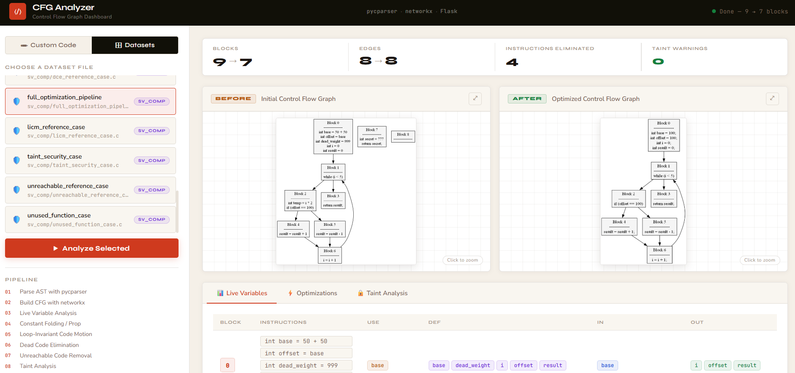
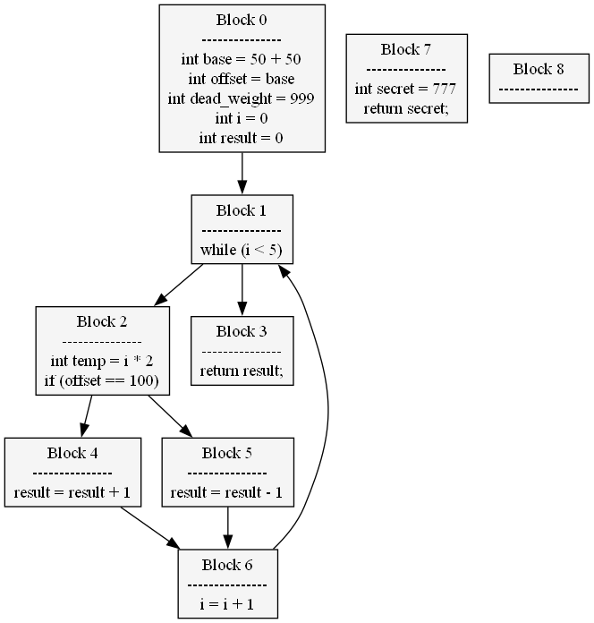
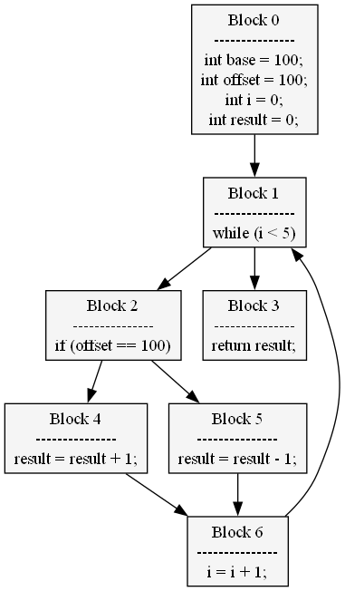

# CFG Analyzer

CFG Analyzer builds Control Flow Graphs (CFGs) from C programs, performs static analysis, applies compiler-style optimizations, and visualizes the graph before and after optimization.

The project can be used in two ways:

- Run `main.py` to process every C file under `datasets/` and save PNG graphs to `output/`.
- Run `app.py` to use the interactive Flask dashboard in a web browser.

## Screenshots

### CFG Analyzer Dashboard



### Before Optimization



### After Optimization



## Features

- C parsing with `pycparser`
- CFG construction with `networkx`
- Graph rendering with Graphviz through `pydot`
- Live-variable analysis
- Constant folding and propagation
- Loop-invariant code motion (LICM)
- Dead-code elimination
- Unreachable-code removal
- Basic source-to-sink taint analysis for `scanf` and `printf`
- Side-by-side before/after graph visualization in the web dashboard

## Analysis Pipeline

For each C program, the analyzer:

1. Parses the source code into an abstract syntax tree.
2. Builds a directed control flow graph.
3. Renders the CFG before optimization.
4. Runs live-variable analysis.
5. Applies constant folding and propagation.
6. Applies loop-invariant code motion.
7. Eliminates dead instructions.
8. Removes unreachable blocks.
9. Runs basic taint analysis.
10. Renders the optimized CFG.

## Project Structure

```text
3_PPP/
|-- app.py                     # Flask web application
|-- main.py                    # Command-line batch pipeline
|-- requirements.txt           # Python dependencies
|-- README.md
|-- datasets/
|   |-- actual/                # Additional C programs
|   |-- codenet/               # CodeNet-style examples
|   `-- sv_comp/               # Optimization and analysis examples
|-- fake_libc_include/         # Minimal headers used by pycparser
|-- src/
|   |-- core_parser.py         # C parser and basic-block construction
|   |-- graph_builder.py       # NetworkX graph construction
|   |-- static_analysis.py     # Live-variable analysis
|   |-- optimizer.py           # Optimization passes
|   `-- bonus_features.py      # LICM and taint analysis
|-- static/
|   |-- app.js                 # Dashboard behavior
|   `-- style.css              # Dashboard styling
|-- templates/
|   `-- index.html             # Flask page template
`-- output/                    # Generated automatically at runtime
```

The `output/` directory may not exist immediately after cloning. It is created automatically when either application needs it.

## Requirements

- Python 3.9 or newer
- Graphviz installed on the operating system and available in `PATH`
- Python packages listed in `requirements.txt`:
  - Flask
  - NetworkX
  - pydot
  - pycparser

Installing `pydot` does not install the Graphviz system executable. Graph generation requires both.

## Installation

Clone the repository and enter its directory:

```bash
git clone <repository-url>
cd 3_PPP
```

Create and activate a virtual environment.

On Windows PowerShell:

```powershell
python -m venv .venv
.venv\Scripts\Activate.ps1
```

On macOS or Linux:

```bash
python3 -m venv .venv
source .venv/bin/activate
```

Install the Python dependencies:

```bash
pip install -r requirements.txt
```

Confirm that Graphviz is available:

```bash
dot -V
```

## Command-Line Usage

Run the batch analyzer from the repository root:

```bash
python main.py
```

The script discovers every `*.c` file under `datasets/` recursively. For each successfully processed file, it writes:

```text
output/<filename>_BEFORE.png
output/<filename>_AFTER.png
```

Taint-analysis results and processing status are printed in the terminal.

## Web Dashboard

Start the Flask application from the repository root:

```bash
python app.py
```

Then open:

```text
http://127.0.0.1:5000
```

The dashboard allows you to:

- Paste custom C source code.
- Select one of the included dataset files.
- View the CFG before and after optimization.
- Inspect live-variable `USE`, `DEF`, `IN`, and `OUT` sets.
- Review changes made by each optimization pass.
- View taint-analysis warnings.
- Enlarge graph images using the built-in lightbox.

The web application creates temporary graph images under `output/tmp/`, converts them to base64 for display in the browser, and removes the temporary image files afterward.

## Included Datasets

The repository contains examples in three groups:

- `datasets/actual/`: additional C source programs.
- `datasets/codenet/`: small general-purpose examples.
- `datasets/sv_comp/`: focused examples for folding, propagation, dead-code elimination, LICM, unreachable code, and taint analysis.

To analyze another file with the batch pipeline, place a `.c` file anywhere below `datasets/` and rerun `python main.py`.

## Current Limitations

- The CFG builder supports a simplified subset of C.
- `if`, `while`, declarations, assignments, function calls, and return statements are the primary supported constructs.
- Constant propagation is local to individual graph blocks.
- LICM is intentionally lightweight and handles only the loop structure recognized by the current CFG builder.
- Taint analysis treats `scanf` as a source and `printf` as a sink; it is not a complete security analyzer.
- Complex system headers may not parse. Minimal replacements are provided in `fake_libc_include/`.
- Automated tests are not currently included in this repository.

## Troubleshooting

### Graphviz executable not found

Install Graphviz and make sure the directory containing `dot` is included in your system `PATH`. Restart the terminal after changing `PATH`.

### A C file fails to parse

Try reducing unsupported language features or complex header dependencies. The analyzer is intended for small C examples rather than complete production codebases.

### Web page loads but graph generation fails

Confirm that both the Python dependencies and the Graphviz executable are installed, then run `dot -V` in the same terminal used to start Flask.

## Notes

- Run commands from the repository root so relative dataset and output paths resolve correctly.
- Generated files under `output/` can be recreated by running the analyzer again.
- The Flask development server is intended for local development and demonstration.
